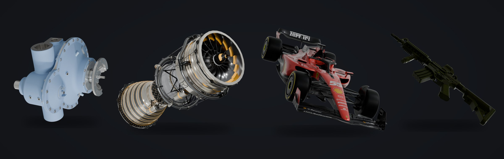
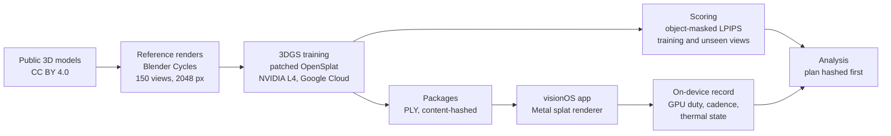
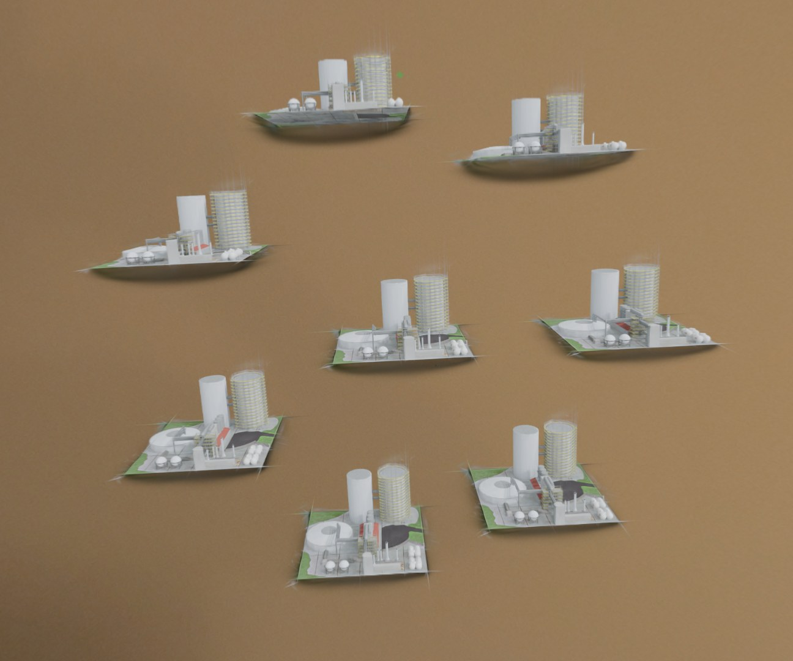
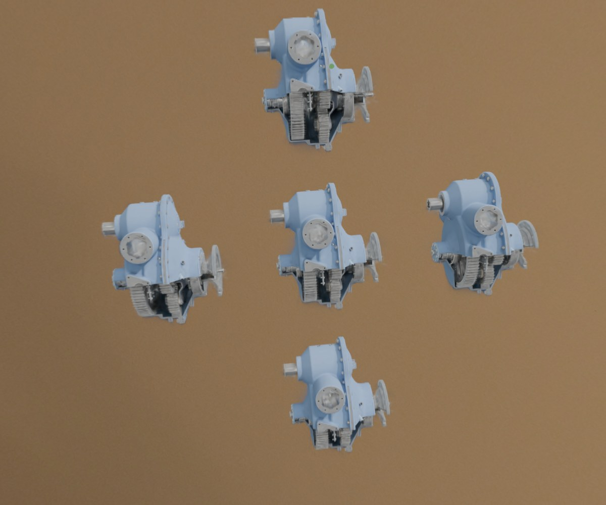
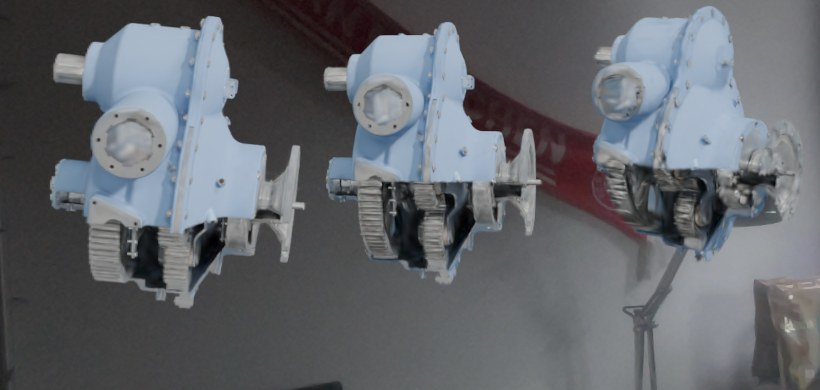
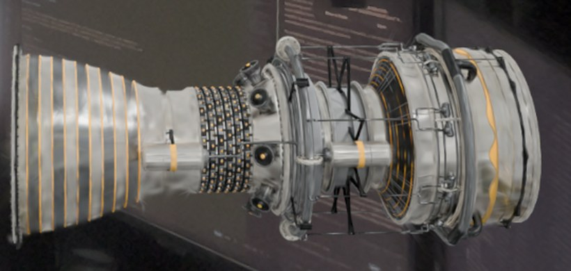

# Gaussian Splatting on Apple Vision Pro

**A splat model that looks perfect on a laptop is only half done. On a standalone headset that draws every frame twice, the other half is measured in GPU time, frame rate and heat.**

`3D Gaussian Splatting` · `Apple Vision Pro` · `visionOS` · `Metal` · `Swift` · `Python` · `PyTorch` · `Blender` · `Google Cloud` · `Experimental Design` · `Reproducible Research`

| My role | Setting | Scale | Public scope |
|---|---|---|---|
| End to end: study design, training and scoring pipeline, the visionOS measurement app, every session on the headset, statistics and the release | Research at the Technical University of Munich, 2026; Apple Vision Pro and NVIDIA L4 GPUs on Google Cloud | 470 trained splat models, 203,520 per-view scores, 195 measurement windows on the headset, a 6.4 GB release of 3,553 files | Question, method, engineering and evidence standards; results, code and data on request |

**In numbers**

- **470** Gaussian splat models trained, 30,000 steps each: **14.1 million** optimisation steps, every model identified by its SHA-256 hash and audited against its configuration;
- **750** ground-truth images: five public 3D models, each rendered from **150** directions at **2048 × 2048** px in Blender Cycles;
- **203,520** per-view fidelity scores from my own CPU splat rasterizer, each tied to a hashed model and a camera;
- **195** accepted 30-second measurement windows on Apple Vision Pro, from **75** block attempts in **7** stages, all on one locked build;
- **545,903** per-frame GPU timings read from Metal command buffers, with the thermal state sampled at **4 Hz** in every window;
- **228** device analysis tables that one command regenerates byte for byte, backed by **277** automated tests;
- **5** recompute commands that rebuild every reported number from the raw records; the offline one alone runs **374** checks, with **0** mismatches when run from the unpacked release archives.

## The question

3D Gaussian Splatting turns a set of images into a cloud of soft, coloured ellipsoids that render in real time. A desktop GPU handles that comfortably. Apple Vision Pro has to render every frame for both eyes, keep pace with a display running at 90 to 100 Hz, stay inside the thermal limits of a headset, and hold up while the user walks around the object.

Splat pipelines make many design choices during training, and most of them are judged by one number on a benchmark. I isolated one of those choices and followed it all the way to the device: how faithful the model is, on the views it was trained on and on views it never saw, and what it costs the headset to draw it. That takes a controlled experiment offline and a measurement instrument on the headset, built to the same standard.

## From 3D model to splat to score

- **Ground truth I control.** Five detailed public models, from a gearbox with a cutaway housing and a turbofan engine to a Formula 1 car and an industrial plant with 13,129 mesh parts and 2.56 million triangles. Each is rendered from 150 directions with one Blender Cycles rig. No capture noise and no pose estimation, so every difference I measure comes from the splats.
- **A controlled comparison.** In the main study, both sides of every comparison start from the same bytes and share cameras, seeds and schedule; they differ only in the choice under study. Several model sizes and three training seeds on every object, in two experiments: one scores each model on the 150 views it was trained on, the other trains on 120 views and scores only the 30 it never saw.
- **Training at scale.** One patched OpenSplat binary, identified by its SHA-256, trains every model for 30,000 steps on NVIDIA L4 GPUs on Google Cloud. Every model is audited against its configuration, and the largest follow-up ran under a cost guard, with a watchdog on a second machine ready to stop the VM.
- **Scoring that looks at the object.** Depending on the object, it fills a median of 7 to 13 % of each image, and as little as 2.5 %, so a whole-image score would mostly grade empty background. Fidelity is object-masked LPIPS, view by view, from my own EWA splat rasterizer in NumPy, independent of the trainer's CUDA code. Confidence intervals come from a hierarchical bootstrap with 10,000 resamples, and the smallest effect worth reporting was fixed before any result existed.

*Status: complete; both experiments trained, scored and audited.*

## On the headset

| Eight plants | Five gearboxes |
|---|---|
|  |  |
| **Three gearboxes** | **The jet engine, close up** |
|  |  |

*Screenshots from Apple Vision Pro, in passthrough.*

Frame rate alone hides too much on a headset, so I built a native visionOS measurement app around a Metal splat renderer (a patched open-source fork):

- **GPU duty per window**: the union of the command buffers' busy intervals, from their own GPU timestamps, as a share of the window, recorded with the achieved frame cadence and the thermal state.
- **A load ladder** of 1, 3, 5 and 8 copies of a model, because one copy does not stress the chip.
- **Rested blocks:** a heavy block starts only after a 900 s rest, and a sitting ends after 45 minutes on the head.
- **Sustained runs** that stop at the first non-nominal thermal sample or after 1,200 s, so the stop itself is the measurement.
- **A saturation rule** fixed before the data, so a window that hits the GPU ceiling is flagged and kept out of the averages.
- **The plan inside the binary:** the hashes of the pre-registration and the capture plan are compiled into the app and written into every window record.

*Status: complete; one command regenerates all 228 device tables byte for byte.*

## What the headset taught me

- **The display mode is part of the measurement.** Two early sessions with the same conditions ran at 90 Hz and at 100 Hz, and the median GPU time per condition moved by −6 % to +55 %. Inside one export this was invisible; comparing two exports of identical conditions made it obvious. From then on, windows were never pooled across modes.
- **Lighting does not control the mode.** If the room's lighting controlled the refresh mode, the protocol could have fixed it. I tested that with a palindromic lamp sequence (on, on, off, off, off, off, on, on, so a linear drift over time cancels out) in three repetitions, with the pass criterion written an hour before the first window. The mode was not controllable, so it stays a recorded factor; the lighting is standardised anyway.
- **A watchdog bug, modelled and fixed without a new build.** Mid-campaign, visionOS killed the app five times. Crash reports showed the main thread decoding the growing on-device checkpoints. I calibrated the scan time against checkpoint size (0.79 s plus 0.099 s per MB, with the 10 s watchdog limit at about 80 to 90 MB) and finished on the same build: each completed stage was exported, its hash verified, the copy archived, and the on-device file replaced by a stub. No accepted window was lost or repeated.
- **Failures stay in the record.** 75 block attempts produced the 195 windows. 18 ended at the gates with no window, and the study reports every one of them, including the stalls whose cause was never proven.

## Findings, in broad strokes

- The choice I studied matters twice: it changes how faithful the model is, on unseen views too, and it changes what the headset pays to draw it. How much depends strongly on the object; a single benchmark object would have told a different story depending on which one it was.
- A follow-up experiment of 98 trainings, planned and hashed before it started, narrowed down where the effect comes from.

Detailed results are available on request.

## Where the study could lie to me

With hundreds of models, the easiest results to produce are wrong ones. Most of the work went into making that hard:

- **Plans before data.** The main analysis, the device protocol and the follow-up were written down and hashed before their data existed. The device study was pre-registered; its ten amendments and every deviation are dated and kept in the record.
- **Audits on every trained model**, checking that each training did what its configuration said.
- **A failed run, disclosed.** The first complete run under an earlier training recipe was scored before its renders were inspected; on screen it was unusable. I voided it, repaired the recipe, re-qualified it and kept the episode in the record.
- **Blind visual reads** of renders, with the key sealed until the reads were recorded.
- **Quality checks before outcomes.** Every device stage passed its data-quality checks with the cost values hidden.
- **Unblinding by reproduction.** Before anyone read a cost table, an independent rerun of the analysis had to reproduce every output hash.
- **Conventions stress-tested.** Pixel sampling, background compositing and five interval constructions were re-run to see which conclusions survive.

## My contribution

I ran the project end to end: the research question and the study design, the rendering and training pipeline on cloud GPUs, the scoring code and the statistics, the native visionOS measurement app, every session on the headset, and the release that rebuilds every number.

## Why it matters

For engineering, the study is a complete path from a 3D asset to a measured experience on a standalone headset: training infrastructure, a renderer on Metal, on-device instrumentation and a release someone else can rerun. For research, it is a controlled experiment with pre-registered analyses, blind reads, disclosed failures and every number traceable to a file.

## Stack

| Offline | On device | Analysis and release |
|---|---|---|
| Blender Cycles, OpenSplat (patched, CUDA, LibTorch), PyTorch, LPIPS, a NumPy EWA splat rasterizer, NVIDIA L4 GPUs on Google Cloud, job queues with model checks | Swift, SwiftUI, Metal, RealityKit, visionOS on Apple Vision Pro | Python (NumPy, SciPy), hierarchical and crossed bootstraps, variance-component checks, SHA-256 manifests |

## Scope

This page is a portfolio case study of the question, the method and the engineering. The results, the code, the trained models and the per-view records are not published here. All data was generated by me from public models.

## Credits

The images on this page are renders of, or Gaussian splat models trained from, these models, licensed under [CC BY 4.0](https://creativecommons.org/licenses/by/4.0/). Changes: mesh parts joined and each model centred; the rifle's stray placeholder cube removed.

- ["Gearbox (Propeller Turbine)"](https://sketchfab.com/3d-models/gearbox-propeller-turbine-9c5f775f4c4b447496c9846ce7638b4b) by [T-FLEX CAD ST](https://sketchfab.com/tflexcad)
- ["Industrial Plant"](https://sketchfab.com/3d-models/industrial-plant-ee3e0660c7d84699a07ea96fe88063e9) by [MEC CAD](https://sketchfab.com/mec_cad)
- ["Turbine | Turbofan Engine | Jet Engine"](https://sketchfab.com/3d-models/turbine-turbofan-engine-jet-engine-74c6aceed86b4a41aaad3b93afc3e262) by [blenderbirb](https://sketchfab.com/blenderbirb)
- ["m4 Carbine Rifle"](https://sketchfab.com/3d-models/m4-carbine-rifle-37cafb82ae144484a26e9ab71a0f8f0e) by [Pieter Ferreira](https://sketchfab.com/Badboy17Aiden)
- ["Scuderia Ferrari F1 SF23 2023"](https://sketchfab.com/3d-models/scuderia-ferrari-f1-sf23-2023-ecb0f812bc454331bbe721655b0780ec) by [Redgrund](https://sketchfab.com/redgrund). The Ferrari name and marks shown on the model belong to their owners and are not covered by the model's licence.

© 2026 Jakub Majewski. Text and screenshots: all rights reserved. The 3D models keep their own licences, listed above.
