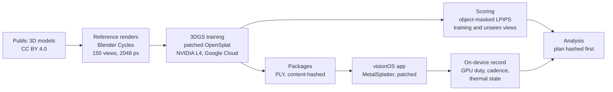

# Gaussian Splatting on Apple Vision Pro

A controlled study of one training choice in 3D Gaussian Splatting, from public 3D models to measurements on the headset. It measures how faithful the trained models are and what they cost to render.

`3D Gaussian Splatting` · `visionOS` · `Metal` · `Swift` · `Python` · `PyTorch` · `CUDA` · `Blender` · `Google Cloud` · `Experimental Design` · `Reproducible Research`

| My role | Setting | Scale | Public scope |
|---|---|---|---|
| End to end: study design, training and scoring pipeline, the visionOS measurement app, every session on the headset, statistics and the release | Research at the Technical University of Munich in 2026. Apple Vision Pro and NVIDIA L4 GPUs on Google Cloud | 470 trained splat models, 203,520 per-view scores, 195 measurement windows on the headset, a 6.4 GB release of 3,553 files | Question, method, engineering and evidence standards. Results, code and data are not public |

**In numbers**

- **470** Gaussian splat models trained, 30,000 steps each. That's **14.1 million** optimisation steps. Every model is identified by its SHA-256 hash and audited against its configuration.
- **750** ground-truth images. I rendered five public 3D models from **150** directions each, at **2048 × 2048** px in Blender Cycles.
- **203,520** per-view fidelity scores from my own CPU splat rasterizer. Each score is tied to a hashed model and a camera.
- **195** accepted 30-second measurement windows on the headset. They came from **75** block attempts in **7** stages, all on one locked build.
- **545,903** per-frame GPU timings read from Metal command buffers, plus the thermal state sampled at **4 Hz** in every window.
- **228** device analysis tables that one command regenerates byte for byte, with **277** automated tests behind them.
- **5** recompute commands that rebuild every reported number from the raw records. The offline one alone runs **374** checks, with **0** mismatches when run from the unpacked release archives.

## The question

3D Gaussian Splatting turns a set of images into a cloud of soft, coloured ellipsoids that render in real time. A desktop GPU has no trouble with that. The headset has to render every frame for both eyes and keep pace with a display running at 90 to 100 Hz. It also has to stay inside the thermal limits of a headset and hold up while the user walks around the object.

Splat pipelines make a lot of design choices during training and most of them get judged by one number on a benchmark. I isolated one of those choices and followed it to the device. The study asks how faithful the model is, on the views it was trained on and on views it never saw, and what it costs the headset to draw it. That takes a controlled experiment offline and a measurement app on the headset.

## From 3D model to splat to score

- **Ground truth I control.** Five detailed public models. They go from a gearbox with a cutaway housing and a turbofan engine to a Formula 1 car and an industrial plant with 13,129 mesh parts and 2.56 million triangles. Each is rendered from 150 directions with one Blender Cycles rig. There's no capture noise and no pose estimation. So every difference I measure comes from the splats.
- **A controlled comparison.** In the main study both sides of every comparison start from the same bytes and share cameras, seeds and schedule. The only difference between them is the choice I studied. Several model sizes and three training seeds on every object, in two experiments. In one of them each model gets scored on the 150 views it was trained on. The other trains on 120 views and scores just the 30 it never saw.
- **Training at scale.** One patched OpenSplat binary trains every model for 30,000 steps on NVIDIA L4 GPUs on Google Cloud. The binary is identified by its SHA-256. Every model gets audited against its configuration. The largest follow-up ran under a cost guard, and a watchdog on a second machine was ready to stop the VM.
- **Scoring that looks at the object.** Depending on the object it fills a median of 7 to 13 % of each image, and as little as 2.5 %. So a whole-image score would mostly grade empty background. Fidelity is object-masked LPIPS, view by view. The scores come from my own EWA splat rasterizer in NumPy, independent of the trainer's CUDA code. Confidence intervals use a hierarchical bootstrap with 10,000 resamples. And I fixed the smallest effect worth reporting before any result existed.

*Status: complete. Training and scoring are done for both experiments and so are the audits.*

## On the headset

| Eight plants | Five gearboxes |
|---|---|
|  |  |
| **Three gearboxes** | **The jet engine, close up** |
|  |  |

*Screenshots from the headset in passthrough.*

Frame rate alone isn't enough on a headset, so I built a native visionOS measurement app. It renders with the open-source [MetalSplatter](https://github.com/scier/MetalSplatter), using [Markus Lanxinger's fork](https://github.com/lanxinger/MetalSplatter). Both are MIT licensed. I patched the renderer to draw several models in one frame and to time every render pass on the GPU, and offered the timing patch upstream as [pull request #73](https://github.com/scier/MetalSplatter/pull/73). The measurement protocol in the app:

- **GPU duty per window**: the union of the command buffers' busy intervals (from their own GPU timestamps) as a share of the window. It's recorded with the achieved frame cadence and the thermal state.
- **A load ladder** of 1, 3, 5 and 8 copies of a model because one copy doesn't stress the chip.
- **Rested blocks:** a heavy block only starts after a 900 s rest. A sitting ends after 45 minutes on the head.
- **Sustained runs** that stop at the first non-nominal thermal sample or after 1,200 s. The time until the stop is the measurement.
- **A saturation rule** fixed before the data. Any window that hits the GPU ceiling gets flagged and kept out of the averages.
- **The plan inside the binary:** the hashes of the pre-registration and the capture plan are compiled into the app. They also get written into every window record.

*Status: complete, and one command regenerates all 228 device tables byte for byte.*

## What I learned on the headset

- **The display mode is part of the measurement.** Two early sessions with the same conditions ran at 90 Hz and at 100 Hz. The median GPU time per condition moved by −6 % to +55 %. It wasn't visible inside one export, only when I compared two exports of identical conditions. From then on I never pooled windows across modes.
- **Lighting doesn't control the mode.** The protocol could have fixed the refresh mode if the room's lighting controlled it. I tested that with a palindromic lamp sequence (on, on, off, off, off, off, on, on, so a linear drift over time cancels out) in three repetitions. I wrote down the pass criterion an hour before the first window. The mode wasn't controllable so it stays a recorded factor. The lighting is standardised anyway.
- **A watchdog bug, modelled and fixed without a new build.** Mid-campaign, visionOS killed the app five times. Crash reports showed the main thread decoding the growing on-device checkpoints. I calibrated the scan time against checkpoint size (0.79 s plus 0.099 s per MB, with the 10 s watchdog limit at about 80 to 90 MB) and finished on the same build. I exported each completed stage and checked its hash. Then I archived the copy and replaced the on-device file with a stub. No accepted window was lost or repeated.
- **Failures stay in the record.** 75 block attempts produced the 195 windows. 18 of them ended at the gates with no window. The study reports every one, including the stalls whose cause was never proven.

## Findings, in broad strokes

- The choice I studied changes both how faithful the model is, on unseen views too, and what it costs the headset to draw it. How much depends strongly on the object. With a single benchmark object the conclusion would depend on which object was picked.
- A follow-up experiment of 98 trainings narrowed down where the effect comes from. I planned and hashed it before it started.

Detailed results are not public.

## Guarding against wrong results

With hundreds of models it's easy to produce wrong results. Most of the work went into preventing that:

- **Plans before data.** I wrote down and hashed the main analysis, the device protocol and the follow-up before their data existed. The device study was pre-registered. Its ten amendments and every deviation are dated and kept in the record.
- **Audits on every trained model** that check each training did what its configuration said.
- **A failed run, disclosed.** I scored the first complete run under an earlier training recipe before I'd looked at its renders. On screen it was unusable. I voided it, repaired the recipe and re-qualified it. The episode stays in the record.
- **Blind visual reads** of renders. The key stayed sealed until the reads were recorded.
- **Quality checks before outcomes.** Every device stage passed its data-quality checks while the cost values were hidden.
- **Unblinding by reproduction.** Before anyone read a cost table, an independent rerun of the analysis had to reproduce every output hash.
- **Conventions stress-tested.** I re-ran pixel sampling, background compositing and five interval constructions to see which conclusions survive.

## My contribution

I ran the project end to end: the research question and study design, the rendering and training pipeline on cloud GPUs, the scoring code and statistics, and the native visionOS measurement app. I also did every session on the headset and put together the release that rebuilds every number.

## What it covers

For engineering the study is a complete path from a 3D asset to measurements on a standalone headset. That covers training infrastructure, a renderer on Metal, on-device instrumentation and a release someone else can rerun. As research it's a controlled experiment with pre-registered analyses, blind reads, disclosed failures and every number traceable to a file.

## Stack

| Offline | On device | Analysis and release |
|---|---|---|
| Blender Cycles, OpenSplat (patched, CUDA, LibTorch), PyTorch, LPIPS, a NumPy EWA splat rasterizer, NVIDIA L4 GPUs on Google Cloud, job queues with model checks | Swift, SwiftUI, Metal, RealityKit, visionOS | Python (NumPy, SciPy), hierarchical and crossed bootstraps, variance-component checks, SHA-256 manifests |

## Scope

This page is a portfolio case study of the question, the method and the engineering. The results, the code, the trained models and the per-view records are not published here. I generated all of the data myself, from public models.

## Credits

The images on this page are renders of, or Gaussian splat models trained from, these models, licensed under [CC BY 4.0](https://creativecommons.org/licenses/by/4.0/). Changes: mesh parts joined and each model centred; the rifle's stray placeholder cube removed.

- ["Gearbox (Propeller Turbine)"](https://sketchfab.com/3d-models/gearbox-propeller-turbine-9c5f775f4c4b447496c9846ce7638b4b) by [T-FLEX CAD ST](https://sketchfab.com/tflexcad)
- ["Industrial Plant"](https://sketchfab.com/3d-models/industrial-plant-ee3e0660c7d84699a07ea96fe88063e9) by [MEC CAD](https://sketchfab.com/mec_cad)
- ["Turbine | Turbofan Engine | Jet Engine"](https://sketchfab.com/3d-models/turbine-turbofan-engine-jet-engine-74c6aceed86b4a41aaad3b93afc3e262) by [blenderbirb](https://sketchfab.com/blenderbirb)
- ["m4 Carbine Rifle"](https://sketchfab.com/3d-models/m4-carbine-rifle-37cafb82ae144484a26e9ab71a0f8f0e) by [Pieter Ferreira](https://sketchfab.com/Badboy17Aiden)
- ["Scuderia Ferrari F1 SF23 2023"](https://sketchfab.com/3d-models/scuderia-ferrari-f1-sf23-2023-ecb0f812bc454331bbe721655b0780ec) by [Redgrund](https://sketchfab.com/redgrund). The Ferrari name and marks shown on the model belong to their owners and are not covered by the model's licence.

© 2026 Jakub Majewski. Text and screenshots: all rights reserved. The 3D models keep their own licences, listed above.
