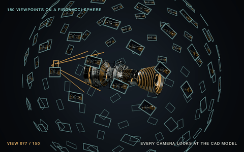

# The view rig: 150 viewpoints on a Fibonacci sphere

[](https://github.com/jacobemanuel/gaussian-splatting-vision-pro/actions/workflows/view-rig.yml)

A small piece of the study: the camera rig every CAD model is rendered with, taken out with its tests. It gives the same camera poses as the study's render script. Nothing in it touches the training choice or the results, which stay private.



## What it does

- **150 directions on a Fibonacci sphere.** The cosine of the polar angle steps evenly and the azimuth turns by the golden ratio each time. Every band of the sphere gets the same share of cameras, at the poles as much as at the equator, and each camera's nearest neighbour is 14.5 to 15.9 degrees away.
- **One camera per direction, looking at the model's centre.** The radius comes from the model's bounding box diagonal, twice the diagonal by default. The camera is turned the shortest way from its own −Z axis onto the view direction, which is what Blender's `to_track_quat('-Z', 'Z')` does, so the roll of the picture changes from view to view.
- **The poses in the trainer's world.** Blender is Z-up, the splat trainer reads Y-up poses in a nerfstudio-style `transforms.json`. The world is turned by multiplying each pose from the left. Multiplying from the right would turn every camera about its own axis instead, and a test checks that this mistake breaks the views.

## Files

- `view_rig.py`: the rig, in NumPy only. Run it to write the poses for one bounding box.
- `test_view_rig.py`: 12 tests, from the spacing of the directions to a comparison with the rotations Blender 5.2 prints.

## Run it

```bash
pip install numpy pytest
pytest
python view_rig.py --bbox-min -0.5 -0.5 -0.5 --bbox-max 0.5 0.5 0.5 --out transforms.json
```
