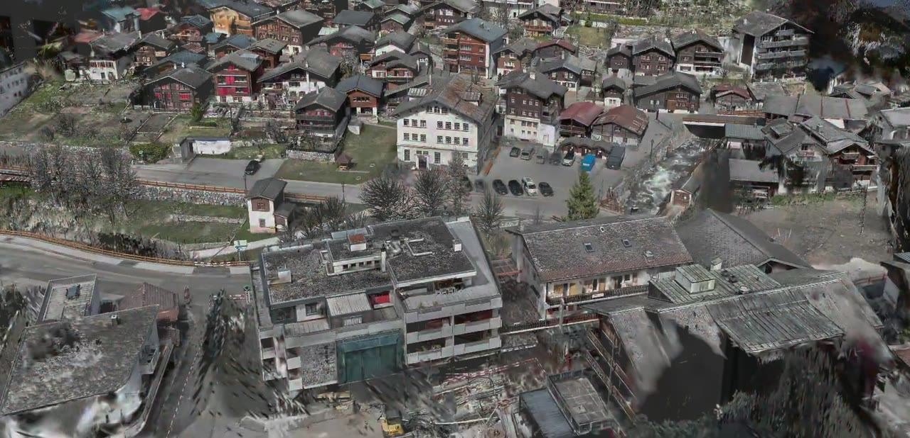
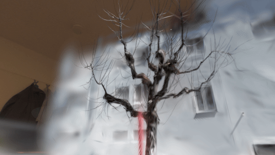
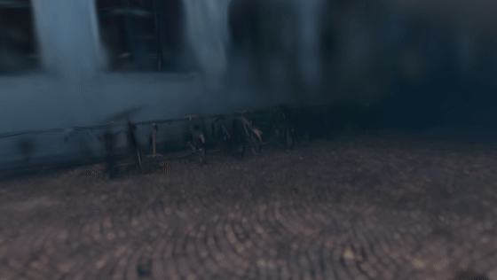
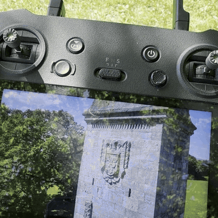
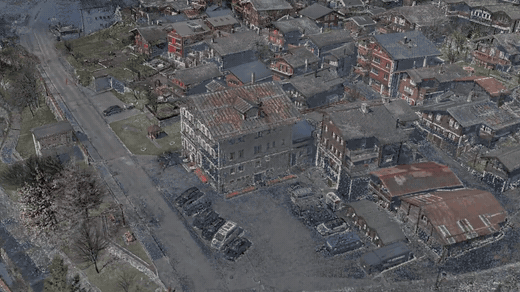

# Large-scale Gaussian Splatting

Three large outdoor scenes I captured myself, turned into Gaussian splats and run on a standalone headset with a dynamic level of detail computed on the device.

`3D Gaussian Splatting` · `Drone capture` · `LCC Studio` · `Level of detail` · `visionOS` · `SuperSplat`

| My role | Setting | Scale | Public scope |
|---|---|---|---|
| Capture from the air and on the ground, processing in LCC Studio, the level of detail on the headset and the Leukerbad video | Research at the Technical University of Munich in 2026, captured with TUM-XR. The standalone headset is an Apple Vision Pro | Three scenes with 91.9 million splats together. The largest has 44.5 million splats in a 1.01 GB file | The three full scenes on SuperSplat and the recordings on this page. The level-of-detail code is private for now |

## In short

- **The problem.** A scene of a whole town or campus has tens of millions of splats. A standalone headset has to sort and draw them for both eyes at the display's rate, on a mobile chip and within its thermal limits.
- **What I did.** I captured three outdoor scenes with TUM-XR, from a drone and on the ground, and processed them in LCC Studio. On the headset they run with a dynamic level of detail that's computed on the device, so not every splat is drawn in every frame.
- **Where it stands.** The recordings below are first results from the headset. The level of detail is still in development and is part of my research at TUM.
- **The evidence.** The full scenes are public on SuperSplat, where anyone can open them in a browser. The recordings on this page come from the headset and the drone.

## The scenes

| Scene | Splats | File on SuperSplat | Open it |
|---|---|---|---|
| Bismarck Tower near Lake Starnberg, Bavaria, captured from the air and on the ground | 44.5 million | 1.01 GB | [SuperSplat](https://superspl.at/scene/77398c1a) |
| Leukerbad, an Alpine town in Valais, Switzerland | 23.3 million | 528.68 MB | [SuperSplat](https://superspl.at/scene/5fceed98) |
| Technical University of Munich, main campus | 24.1 million | 275.13 MB | [SuperSplat](https://superspl.at/scene/193ca7e8) |

The splat counts are for the full scenes. On the headset the level of detail picks what gets drawn in each frame.

## Level of detail on a standalone headset

The level of detail runs entirely on the headset, frame by frame, while the scene is shown.

| Leukerbad | Technical University of Munich |
|---|---|
|  |  |

*Recorded on the headset. In Leukerbad the facade gets sharper as the finer detail comes in. At TUM the middle of the view is sharp and the scene gets coarser towards the edges.*

## Capture

The Bismarck Tower scene combines scans on the ground with a drone flight that circles the tower and climbs.

*The drone's live view on the controller, played twice as fast.*

The flight over Leukerbad comes from the TUM-XR video about the trip, which I made from start to finish.

## Research context

The three scenes are the basis of my research at TUM on Gaussian Splatting for real-time 3D on standalone headsets, which I do together with [Qing Cheng](https://cvg.cit.tum.de/members/cheq) and which is supervised at [Prof. Daniel Cremers' Chair of Computer Vision and Artificial Intelligence](https://cvg.cit.tum.de/members/cremers). The controlled study on the headset from the same research is [the main case study in this repository](https://github.com/jacobemanuel/gaussian-splatting-vision-pro). I also work on large scenes for standalone headsets at [SplatFactory3D](https://splatfactory3d.com/).

## Scope

This page is a portfolio case study. The full scenes are public on SuperSplat. The raw scans and the level-of-detail code are not published here.

© 2026 Jakub Majewski. Text, images and recordings: all rights reserved.
